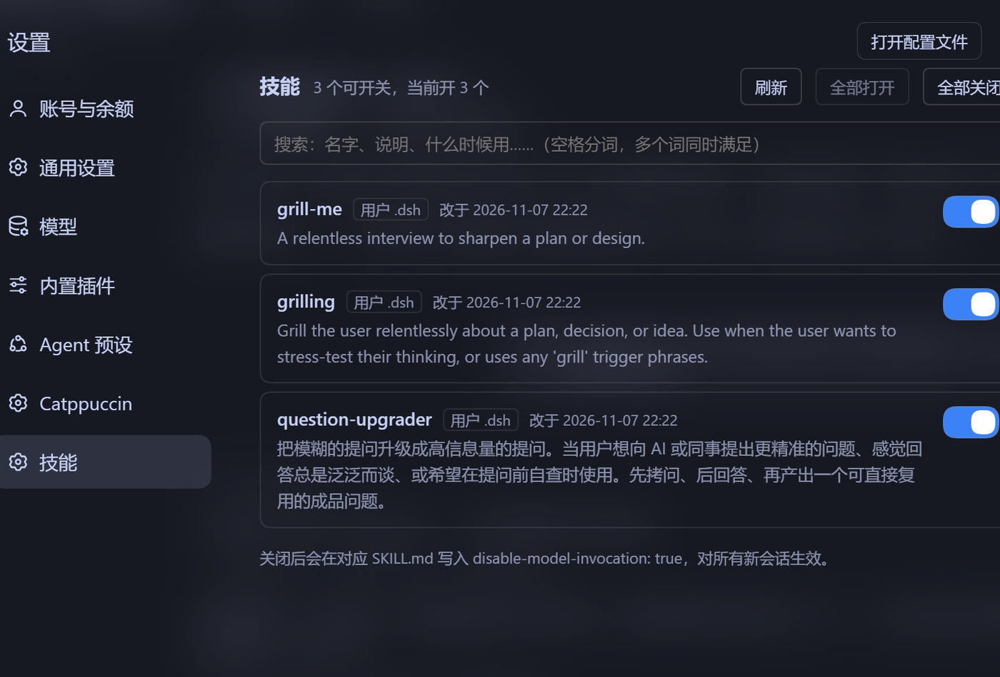

# dsh-skill-board


The missing **Skills page** for DeepSeek Harness: see every Agent Skill your agent can use, and toggle each one with a click.



## Install

1. Clone this repository.
2. Point the plugin manager at the clone:

```text
plugin_manager action=install_bundle target="<absolute path to the clone>"
```

3. Open **Settings → Skills**.

Remove it with:

```text
plugin_manager action=remove_bundle target=@devin-jx/dsh-skill-board
```

Requires a DSH desktop build that ships the Settings UI (`@deepseek-ai/dsh-client-ui-settings`).

## What the page gives you

- **The description, right there** — you can tell what a skill does without opening `SKILL.md`. This is the biggest time saver: it is how you decide whether to keep a skill at all.
- **A search box** — matches name, description, and "when to use" together. Space-separated words must all match. **If you cannot remember the name, search by what it does.** (Type "问" and you will find a skill whose name never contains it.)
- **Last modified time** — tells "I edited this recently" apart from "it has always been like this".
- **Disable all / enable all** — the fastest bisect when you suspect one skill is misbehaving: turn everything off, then re-enable one at a time. Disable-all asks for confirmation; enable-all does not.
- **One click per skill** — writes `disable-model-invocation` into the file.

## Why

Once you have more than a handful of skills, three questions get hard to answer:

1. **Which skills can my agent actually see right now?**
2. **Where did this one come from** — mine, this project, or shipped with the app?
3. **A skill keeps firing when I do not want it — how do I shut it up?**

In DSH all three are filesystem questions. Skills live in five roots (two user-level, two project-level, one bundled), and the switch is one line inside `SKILL.md`:

```yaml
disable-model-invocation: true
```

**Get the key wrong and nothing errors** — the skill just silently drops out of the catalog, and you end up blaming the model for ignoring it.

This page turns that into a list: name, source, description, toggle.

## When you do not need it

- **Two or three skills, and you know where they are** — editing the file is faster.
- **You want "off just for this session"** — this plugin cannot do that. It edits the file, so the change is permanent.
- **You want to switch off a skill shipped inside the app** — those are read-only, and the page hides them.

## What the toggle actually does

Turning a skill off writes this line into its frontmatter:

```yaml
disable-model-invocation: true
```

Turning it back on writes `false`. The change is **permanent** — it applies to every new session, because the file is the state. There is no per-session override.

### Where skills live

| Path | Scope |
| --- | --- |
| `%USERPROFILE%\.dsh\skills\<name>\SKILL.md` | all workspaces |
| `<workspace>\.dsh\skills\<name>\SKILL.md` | that workspace only |

This page lists user-level and bundled skills. Project-level skills are not shown, because the page has no session to resolve a workspace from.

## Security

The HTTP routes have **no authentication**. They are bound to `127.0.0.1`, so they are not reachable from the network, but any local process can call `/skill-board/toggle` and flip a skill. That is fine for a local desktop tool; do not expose this server to a network you do not trust.

## Known limitations

- Only user-level and bundled skills are listed; project-level skills need a session.
- Skills shipped inside the app are read-only and therefore hidden.
- The UI is currently Chinese-only; the agent tool is bilingual.

## Implementation notes (for contributors)

1. `ctx.webServer.register` needs `kind: 'exact'`, and the handler is Node's `(req, res)` — **not** a Web `Request → Response` function. Without `kind`, requests hang until they time out.
2. Skill discovery must receive the calling agent as `scope`; without it only the global layer (bundled skills) is visible.
3. The skill registry caches per working directory. After writing a file, wait for the catalog to observe the change before re-listing, or the UI shows the old state.

## License

MIT