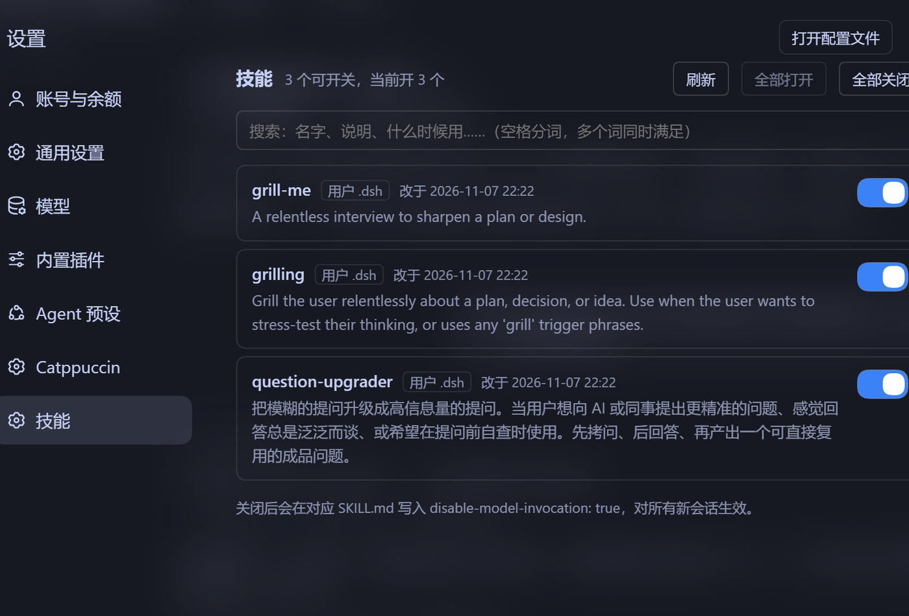

# dsh-skill-board


[English](README.md) | 简体中文

DeepSeek Harness 缺的那一页：**技能管理**。看全 Agent 能用的技能，一个一个点着开关。



## 安装

1. 克隆本仓库
2. 让插件管理器指向克隆下来的目录：

```text
plugin_manager action=install_bundle target="<克隆到的绝对路径>"
```

3. 打开 **设置 → 技能**

卸载：

```text
plugin_manager action=remove_bundle target=@devin-jx/dsh-skill-board
```

要求：带设置面板的 DSH 桌面版（`@deepseek-ai/dsh-client-ui-settings`）。

## 页面里有什么

- **每个技能的说明直接列出来** —— 不用打开 `SKILL.md` 就知道它是干什么的。这是最省时间的一项：判断"这个技能要不要留"全靠它
- **搜索框** —— 名字、说明、什么时候用，三处一起搜；空格分词，多个词要同时满足。**记不住名字就按描述搜**（比如打「提问」，能搜到名字里根本没这个词的技能）
- **改于什么时候** —— 一眼看出是"我最近动过"还是"它本来就这样"
- **全部关闭 / 全部打开** —— 排查「是不是某个技能在捣乱」时最快的二分法：先全关，再一个个打开。全关要二次确认，全开不用
- **点一下开关** —— 等价于改文件里的 `disable-model-invocation`

## 为什么需要它

技能装到十几个以后，这三个问题会变得很难回答：

1. **我的 Agent 现在到底能看见哪些技能？**
2. **这一条是从哪来的**——我自己装的、这个项目里的，还是随程序自带的？
3. **某个技能老是被误触发，怎么让它闭嘴？**

在 DSH 里，这三个问题都得翻文件系统：技能散在五个目录里（用户级两个、项目级两个、内置一个），开关是 `SKILL.md` 里的一行

```yaml
disable-model-invocation: true
```

**写错这个 key 不会报错**——技能只是静默地从目录里消失，你会以为是模型不肯用它。

这一页把它变成一张列表：名字、来源、说明、开关。

## 什么时候你不需要它

- **只有两三个技能，而且都知道在哪** —— 直接改文件更快
- **想「只在这个会话关掉」** —— 这个插件做不到。它改的是文件，永久生效
- **想关掉随程序打包的技能** —— 那些是只读的，页面上也不显示

## 开关到底改了什么

关掉一个技能，等于往它的 frontmatter 里写：

```yaml
disable-model-invocation: true
```

打开则写 `false`。改动是**永久的**——因为文件即状态，所以对所有新会话都生效，没有「只在这个会话关掉」这种模式。

### 技能放在哪

| 路径 | 范围 |
| --- | --- |
| `%USERPROFILE%\.dsh\skills\<name>\SKILL.md` | 所有工作区 |
| `<工作区>\.dsh\skills\<name>\SKILL.md` | 只有那个工作区 |

这个页面列的是用户级和内置技能。项目级技能不显示，因为页面没有会话，拿不到工作区目录。

## 安全

两个路由**没有鉴权**。它们只绑定 `127.0.0.1`，网络上看不到；但本机任何进程都能调 `/skill-board/toggle` 把技能翻转。对本地桌面工具来说这没问题，但别把这个服务暴露到你不信任的网络里。

## 已知限制

- 只列用户级和内置技能；项目级技能需要会话才能解析
- 随程序打包的技能是只读的，所以不显示
- 界面目前只有中文；Agent 工具那边是中英双语

## 给贡献者的实现笔记

1. `ctx.webServer.register` 必须带 `kind: 'exact'`，而且 handler 是 Node 的 `(req, res)`，**不是** Web 的 `Request → Response`。少了 `kind`，请求会一直挂到超时。
2. 查技能目录必须把当前 Agent 作为 `scope` 传进去，否则只能看到全局层（内置技能）。
3. 技能注册表按工作目录缓存。写完文件后要等目录观察到变化再重新列，否则界面会显示旧状态。

## 许可证

MIT